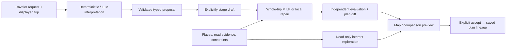

<div align="center">

# Weather-Aware Travel Itinerary Optimization

### Plan less. Adapt smarter. Keep the trip worth taking.

An interactive travel-planning research prototype: describe a change in natural language, explore places through a personalized interest map, and inspect an optimized itinerary before accepting it. The project connects an optional LLM to my constrained itinerary optimizer and an independent repair evaluator.

[](https://www.python.org/)
[](https://fastapi.tiangolo.com/)
[](https://www.gurobi.com/)
[](src/itinerary_system/product_app/trip_solver.py)
[](https://www.openstreetmap.org/)
[](LICENSE)

[Quick start](#quick-start) · [Demo](#product-walkthrough) · [LLM](#llm-copilot-and-individualized-planning) · [Interest regions](#personalized-interest-regions) · [Optimizer](#my-optimizer) · [Repair](#repair-and-explicit-acceptance)

</div>


## What this project does

Travel plans break when weather, closures, travel time, or booking constraints change. This project turns that disruption into a constrained repair problem: preserve as much of the original trip as possible, replace what no longer works, and keep every recommendation inspectable.

- **Individualized planning:** interpret changes to trip length, starting city, required destinations, interests, and daily driving limits through a deterministic or optional OpenAI Copilot.
- **Interest exploration:** inspect nearby places, nature/culture preferences, uncertainty, and 50% / 80% / 95% model-interest regions on the map.
- **Constrained optimization:** jointly select stops, visit order, day assignments, and overnight bases for supported whole-trip requests.
- **Minimal-change repair:** revise supported parts of an existing trip while preserving its other commitments and exposing missing evidence.
- **Inspectable decisions:** review destination details, route geometry, before/after differences, evaluation results, and source links before explicit acceptance.
- **Research comparisons:** retain hierarchical Gurobi, greedy, and hybrid bandit + small-Gurobi planning methods alongside the product workflow.

> **Evidence checkpoint — 29 October 2026:** The [retained Copilot checkpoint](docs/reports/copilot_checkpoint_20261029/README.md) records **339 passing focused checks**, two actual paid OpenAI replacement tests across retained source epochs, and 32 original screenshots. The [repository quality run](https://github.com/Ztang-Yit-Xiaang/weather-aware-travel-itinerary-optimization/actions/runs/40947102646) separately records **4,815 passed and 37 skipped**, with lint and formatting checks passing. These are different verification scopes; neither establishes general language reliability or release readiness.
>
> **Prototype status:** `/app` is an experimental research interface, not a booking product. Explicit acceptance of an eligible evaluated preview is implemented with persistent lineage and rollback. Full stability, integration and release acceptance remain in progress; the [earlier integration status](docs/reports/runtime_coherence_status_20261007.md) preserves its separate evidence and remaining limits.

## Product walkthrough

The current walkthrough captures real browser steps in a disposable seven-day California demo: ask for a local repair, evaluate its draft, explore interest regions on that evaluated preview, inspect a place, and compare the routes.


This is a timed sequence of actual screenshots, rather than a continuous screen recording. It uses the **deterministic adapter** and makes **no paid LLM calls**. See the [capture record](docs/assets/readme/capture-20261029.json) for source identity, steps, and media hashes. It demonstrates the interface and a supported local repair; it does not demonstrate a new whole-trip MILP solve or acceptance.

That earlier capture found a default-parent interest issue (`poi_route_matrix_invalid`). The newer release source now accepts the registered, hash-bound additive route matrix; the [release verification](docs/reports/full_app_release_20261029/README.md) records the subsequent checks. The [original failure screenshot](docs/assets/readme/interest-parent-limitation.jpg) remains historical evidence for the older captured source.

<details>
<summary>Earlier workspace, comparison, and mobile captures</summary>

The earlier animation is also assembled from real application captures, showing the trip workspace, deterministic Copilot, and repair comparison.

<div align="center">


</div>

<table>
  <tr>
    <td width="58%">
      
      <br><sub><b>Explainable assistance.</b> Discuss a disruption without allowing the assistant to silently change the trip.</sub>
    </td>
    <td width="42%">
      
      <br><sub><b>Visible tradeoffs.</b> Compare route evidence, risk, preservation, and edit cost before choosing.</sub>
    </td>
  </tr>
  <tr>
    <td colspan="2" align="center">
      
      <br><sub><b>Responsive inspection.</b> The essential trip and map workflow remains available on a narrow viewport.</sub>
    </td>
  </tr>
</table>

</details>

For the retained live-provider examples, use the separate [32-image checkpoint gallery](docs/reports/copilot_checkpoint_20261029/review.html).

## Quick start

### Windows launcher

1. Clone or download the repository.
2. Double-click [`OPEN_ITINERARY_COPILOT.cmd`](OPEN_ITINERARY_COPILOT.cmd).
3. Keep the terminal open while using the app at `http://127.0.0.1:8127/app`.
4. Press `Ctrl+C` in the terminal when finished.

The launcher starts a loopback-only service, validates the pinned demo run, waits for its health check, and opens the correct page. Do **not** open `src/itinerary_system/product_app/static/index.html` directly: the page requires the application API and will not work from a `file:///` URL.

### Command line

```powershell
python -m pip install -e .
python scripts/run_product_app.py --open
```

The default product demo reads immutable artifacts from:

```text
runs/california-coast-coherent-demo-v1/
```

The registry also includes older weather-repair fixtures. The geographic map requires the separate [local MapLibre/PMTiles asset service](docker/maplibre/README.md); live route checking requires the [local OSRM service](docker/osrm/README.md). Their data packages are kept outside Git. Without the map service, the app exposes a labeled text-route fallback. Existing frozen route evidence and live routing availability are separate.

For experiments, use a separate port and state directory to protect a saved workspace:

```powershell
python scripts/run_product_app.py --port 8139 --state-root tmp/demo-state
```

Configure the map service to allow that app origin as well. State is stored locally under `.product_app_state/` by default; treat it as saved application data when cleaning temporary files.

The older generated research dashboard is still available:

```powershell
python scripts/serve_dashboard.py
```

Open the URL printed in the terminal. GitHub does not render the repository's local HTML dashboards inline, so they must be served or opened locally.

### Low-cost interactive hosting

The deployment package keeps **GitHub Pages** for the interface, uses **Railway**
for FastAPI and the optimizer, **Supabase PostgreSQL/Auth** for private saved state
and owner sign-in, and **OpenRouteService** for road routing. The hosted map uses
attributed OSM raster tiles, so it does not need a separate OSRM or PMTiles host.

Start with free development tiers. Railway Hobby, if later approved, starts at
$5/month including $5 of usage; the intended budget is $5–10 with a spending cap
and sleeping enabled. Continuous uptime within the free allowance is not
guaranteed, and Supabase can pause inactive free projects. Hosted defaults keep
paid OpenAI disabled. See the [deployment guide](docs/deployment/railway_supabase_ors.md)
for current limits, setup, recovery and the exact private/public settings.

**Prepared, not deployed:** no cloud resources or paid plans were created. The
existing public site remains until an authenticated backend is configured and
the manual Pages workflow verifies its matching build. This first hosted version
supports one owner and one backend worker/replica; it is not a public multi-user
service. Its interest map uses the labelled saved place catalog, and hosted chat
delivers its response after the database commit rather than streaming tokens live.

## How it works



### LLM Copilot and individualized planning

The Copilot reads the visible trip and a bounded conversation window. It turns a supported request into a structured proposal with parameters and an action type. The application checks request completeness, identifiers, permissions, and the current revision before staging an edit. Ambiguous or conflicting requirements need clarification; explicit read-only questions preserve the itinerary.

Examples of supported request families include:

| Request | Planning behavior |
| --- | --- |
| “我的旅行計劃有變，我想製作一個10天的旅行計劃” / “我想花兩週去旅行” | Propose a 10- or 14-day whole-trip replan using the supported catalog and inherited constraints. |
| “Start in Los Angeles; I prefer nature and at most three hours of driving a day.” | Pass the start city, declared preference, and daily driving cap to the planner. |
| “Replace Bixby with Pfeiffer Big Sur, keeping the other stops.” | Propose a typed local replacement; execution requires matching directed road evidence. |
| “Add Hearst Castle” or “Add Redwood National Park.” | Request a required destination through the supported planning path, subject to route and access evidence. |
| “Add Channel Islands” / “Give Yosemite three extra days.” | Use specialized excursion or park-extension handling, including its additional evidence and transport limits. |

These describe implemented request paths, not a guarantee that every wording or every combination succeeds. Channel Islands distinguishes the Ventura road stop from an illustrative offshore excursion; the offshore line is not a driving route or a ferry booking. Yosemite reference places, photos, descriptions, and attributed visitor-review material are inspected through destination tabs where available; reference places are not automatically scheduled visits.

The LLM does not calculate or certify an optimal route. It has no direct tool access or authority to accept a plan. Structured requests connect it to the optimizer and evaluator through application-controlled actions. See [Copilot interpretation](src/itinerary_system/product_app/openai_copilot.py), [trip parameters](src/itinerary_system/product_app/trip_planning.py), and [whole-trip execution](src/itinerary_system/product_app/trip_replanner.py).

### Personalized interest regions

The map opens **Interest region** automatically and refreshes it when you select a day or stop. Change the nearby search radius, nature/culture preference, and model-mass level; inspect individual places and browse by name or category. Radius, preference, mass, and explicit hide choices persist per trip. Broad park destinations offer a labeled visitor-area search center alongside the original itinerary pin. Exploration can use the accepted itinerary or a current eligible evaluated preview; browsing a preview does not accept it.

Nearby places combine source-attributed local catalogs with a bounded online lookup and durable cache. The interface distinguishes online, saved, older saved, and bundled-catalog results. A source failure retains usable saved data. **Refresh online places** requests source data; **Refresh estimates** follows the normal cache policy. Cache freshness and access/route validation are separate. See [persistence, search centers, and cache behavior](docs/current/interest_regions.md).

The model combines place features with an explicit stated preference and, when available, explicit feedback. Without feedback it uses an elicited prior. It exposes both point estimates and uncertainty, then builds a land-supported geographic density. These quantities mean different things:

| Display | Meaning |
| --- | --- |
| Estimated interest at a place | Model estimate of preference fit, currently uncalibrated. |
| 90% model uncertainty interval | Uncertainty about that place's model estimate. |
| 50%, 80%, or 95% region | Boundary containing that share of the modeled spatial interest mass. |
| Confirmed must-go marker | A recorded hard commitment, rather than a probability of 100%. |

A colored region does not establish access, opening hours, road connectivity, or whole-itinerary feasibility. Exploring or selecting a place does not silently create a commitment. A supported edit still needs road checking, draft evaluation, and explicit acceptance. See the [interest model](src/itinerary_system/interest_model.py), [geographic surface](src/itinerary_system/interest_surface.py), and [revision-bound product adapter](src/itinerary_system/product_app/interest_regions.py).

### My optimizer

My contribution is the itinerary formulation and its connection to evidence, constraints, repair, and evaluation. The repository uses several solving paths with different scopes:

| Path | What it solves | Backend and scope |
| --- | --- | --- |
| **Interactive whole-trip planner** | Select stops, assign days, order visits, and connect overnight bases while respecting required visits, endpoints, and daily limits. | My mixed-integer linear formulation, solved through **SciPy/HiGHS** over a finite validated California catalog. |
| **Interactive local repair** | Compile supported typed edits against the existing itinerary and frozen route evidence, then evaluate the revised plan. | Deterministic context-aware heuristic; a product replacement is not a claim of global optimality. |
| **Research Progressive Repair** | Generate candidate day routes and select repairs lexicographically, prioritizing preservation and other declared objectives. | Exact selection within the explicit candidate pool; enumeration is the default selector. PlanDiff-based preservation is an opt-in research mode. |
| **Research trip generation and baselines** | Hierarchical planning and comparisons with greedy and bandit-assisted planning. | Gurobi-backed methods require a local license; saved dashboard variants do not rerun Gurobi when clicked. |

For the interactive whole-trip planner, the current objective is:

```text
minimize road travel minutes
       + 15 minutes × added optional stops
       + declared interest-mismatch penalties for optional stops
```

The formulation includes unique visits, required destinations, connected daily paths, continuous overnight bases, and separate daily driving and elapsed-time limits. It records the solver status, objective, bound, gap, runtime, and model size, and checks the returned incumbent's integrality and constraint residuals. `OPTIMAL` refers to this finite formulation and its evidence; a feasible time-limited incumbent is labeled `FEASIBLE`.

This is a linear mixed-integer planning model. A nonlinear/nonconvex extension has not been implemented. Numeric weather risk is not currently a term in the whole-trip objective, and missing risk data remains a [documented limitation](docs/reports/copilot_checkpoint_20261029/risk_inspection.json).

Source: [whole-trip MILP](src/itinerary_system/product_app/trip_solver.py), [research hierarchy](src/itinerary_system/hierarchical_gurobi.py), [progressive repair](src/itinerary_system/repair/progressive.py), and [lexicographic selector](src/itinerary_system/repair/lexicographic.py).

### Repair and explicit acceptance

1. **Describe a change or disruption.** The app keeps the accepted parent plan and records the requested operation and constraints.
2. **Stage the proposal.** A suggestion becomes a typed draft only through its explicit action. Unsupported or missing route evidence blocks execution rather than inventing a route.
3. **Run Preview repair.** The supported planner compiles a child itinerary; the independent evaluator checks feasibility, evidence coverage, and preservation/edit metrics against that exact content.
4. **Inspect the result.** The map, comparison, and evidence views show the evaluated child. A passing certificate has a limited evidence scope; warnings and unavailable metrics remain visible.
5. **Accept explicitly.** Only an eligible current preview can become the saved accepted plan. Acceptance appends durable lineage and updates the accepted-plan pointer; rollback is a separate audited operation.

An LLM response, an exploratory map pin, a staged draft, and an accepted itinerary are distinct states. Revision and content checks prevent an old preview from authorizing a newer edit.

## Demo snapshot

| Dimension | Included in the current demo |
| --- | --- |
| Scenario | Weather-aware California coast itinerary repair |
| Corridor | San Francisco to Los Angeles |
| Trip | 7 days, 8 recorded stops, Day 5 Bixby disruption |
| Candidate catalog | Bounded California discovery catalogs and separately registered route-backed replacement candidates. Discovery is not executable route evidence or exhaustive statewide coverage. |
| Repair signals | Contextual risk, preservation, edit cost, eligibility, and route evidence |
| Route variants | 7-day, 9-day, and 12-day research artifacts |
| Interfaces | Trip, map edit, interest regions, destination-detail tabs, repairs, compare, evidence, settings, and Copilot |

The broader generated artifacts also include customer-facing and research/debug dashboards, lightweight share maps, method comparisons, route playback, hotel candidates, nature exploration, and interest-profile previews.

## Run the research pipeline

Install the package, then execute the production notebook with a trip configuration:

```powershell
python -m pip install -e .
$env:TRIP_CONFIG_PATH = "configs/nature_trip_config.yaml"
python -m jupyter nbconvert `
  --to notebook `
  --execute notebook/production_system_blueprint.ipynb `
  --output production_system_blueprint_nature_executed.ipynb `
  --output-dir notebook `
  --ExecutePreprocessor.timeout=1800 `
  --ExecutePreprocessor.kernel_name=python3
```

A valid local Gurobi license is required for Gurobi-backed optimization routes.

## Optional OpenAI Copilot

The Copilot starts in **Deterministic demo** mode. Requests stay on the computer and no API key is needed. To explicitly select the OpenAI adapter, create a local, Git-ignored `.env.local` file:

```dotenv
PRODUCT_COPILOT_ADAPTER=openai
OPENAI_API_KEY=replace-with-your-local-key
# Optional: select a model available to your API project.
# OPENAI_COPILOT_MODEL=your-model-id
```

If omitted, the model comes from the current [runtime configuration](src/itinerary_system/product_app/config.py). Model availability and cost depend on the API project. Selecting the OpenAI adapter makes submitted model requests billable; the deterministic walkthrough above is separate from the retained paid tests.

The provider receives the visible itinerary context, current message, and a bounded recent conversation window. It has no tools and cannot directly change a plan, booking, permission, or acceptance decision. Local transcripts expire 30 days after the conversation's last activity and can be deleted from Copilot settings; separately retained audit evidence is not deleted by transcript deletion. Never place an API key in a tracked file, screenshot, issue, or chat message.

Inspect the selected provider without making a billed request:

```powershell
$health = Invoke-RestMethod http://127.0.0.1:8127/api/health
$health.components.openai
```

## Project structure

```text
weather-aware-travel-itinerary-optimization/
├── configs/                 Trip and product configurations
├── docs/                    Research, methods, audits, and engineering notes
├── notebook/                Exploration and production notebooks
├── report/                  Course reports, proposals, and presentation material
├── results/                 Generated maps, dashboards, figures, and evidence
├── runs/                    Immutable experiment and product-demo artifacts
├── scripts/                 Launch, export, validation, and pipeline commands
├── src/itinerary_system/    Reusable planning, repair, and product modules
└── tests/                   Pipeline, optimization, API, and interface tests
```

## Validation

Run the full automated suite and static checks:

```powershell
python -B -m pytest --basetemp=tmp/p
python -m ruff format --check src tests scripts
python -m ruff check src tests scripts
python scripts/validate_dashboard_export.py
python scripts/validate_nature_route_pipeline.py --strict
```

Focused product-app checks:

```powershell
python -m pytest tests/product_app -q
python -m ruff check src/itinerary_system/product_app tests/product_app scripts/run_product_app.py
```

Real-browser integration gate (not a mocked API test):

```powershell
python scripts/run_e2e1_vertical_slice.py --browser-test aggregate
```

Stop the normal local app first so port 8127 is free. The runner uses disposable
state, explicitly blocks provider calls, and checks the exact registered browser
journeys and artifact identities. The current inventory is 68 cases in 22 suites;
that inventory is not a completion claim. For just the 11 owned-rule chat/editor
journeys, use `--browser-test owned-edits`. Each run retains exact inputs, outputs,
source hashes, screenshots and an independently checked evidence manifest under
`results/e2e/`. Live GPT connectivity is a separate, explicitly authorized billed
website test and cannot be inferred from this deterministic gate.

## Research and documentation

Start with the [documentation index](docs/README.md), then use the focused references below.

| Document | Purpose |
| --- | --- |
| [Itinerary repair method](docs/methods/repair_method.md) | Repair thesis, records, experiments, and claim boundaries |
| [Nature-aware model extension](docs/methods/nature_aware_model_extension.md) | Interest profiles, nature regions, route balance, and export architecture |
| [Literature onboarding guide](docs/literature/literature_onboarding_guide.md) | Problem framing, terminology, research gap, and reading path |
| [Evidence matrix](docs/literature/evidence_matrix.md) | Implementation-to-literature traceability and remaining novelty |
| [Product audit synthesis](docs/audits/product_audit_synthesis.md) | Current product failures, evidence, and gate status |
| [Copilot implementation plan](docs/planning/itinerary_repair_copilot_implementation_plan.md) | Product contracts, phases, tests, and verification status |
| [Technical specification](docs/planning/travel_itinerary_repair_technical_specification.md) | Parent-plan-aware repair implementation contract |
| [IE 5533 final report](report/IE_5533_Final_Report.pdf) | Original formulation, methods, and academic background |

## Known limitations

- The strongest current demo is California-focused; nationwide routing requires additional data adapters and validation.
- Some generated dashboards switch between saved artifacts or preview routes but do not rerun Gurobi in the browser.
- Live sources may fall back to cached or curated data; provenance and uncertainty remain visible in audit artifacts.
- Congestion and waiting time use proxy signals rather than direct ground-truth queue measurements.
- Interest estimates are uncalibrated; region mass is not a suitability or safety guarantee.
- The older walkthrough retains a default-parent interest failure. The release source includes its registered-matrix fix; newer focused and browser checks are recorded separately from that historical media.
- Official-source checks describe retrieval-time evidence; they do not guarantee future access, wildfire conditions, transport availability, or bookings.
- Quantitative risk coverage is incomplete. A configured evaluation pass does not establish a complete weather-risk assessment or production readiness.
- Generated artifacts can become stale after code or configuration changes and should be rebuilt before being cited as final evidence.

<!-- BEGIN portfolio-project-animations -->
## Recorded project interactions

<details>
<summary>Original research dashboard recording</summary>


The original saved-route dashboard: select routes, click stops, change layers, and use route playback. This recording uses archived data; it is separate from the current Copilot/interest/repair walkthrough and represents no new model inference or optimizer benchmark.

</details>

<!-- END portfolio-project-animations -->

## Contributing

Contributions are welcome, especially around data adapters, route evidence, optimization baselines, dashboard clarity, and user-study preparation. See [CONTRIBUTING.md](CONTRIBUTING.md) for setup and quality checks.

## License

Released under the [MIT License](LICENSE) for academic and research use.
