# G4 Live OpenAI Evidence and AI Engineering Architecture

Date: 2026-08-12
Scope: live provider connection, prompt/context harness, fixed-24 evaluation, reasoning comparison, memory boundary, and system architecture.
Status: **Historical v5 G4 verified / passed for its frozen source snapshot; superseded for current-source status by the verified 2026-08-13 v6 closeout**. The v5 exact file/LLM input-output, HTTP transport, evidence/status, and security/privacy/memory audits all passed. The later statewide-POI/name-aware source is certified separately by `g4_current_source_provider_evidence_20260813.md`; this historical report remains evidence for v5 only. W5 remains closed; Accept and Keep remain disabled.

## Current v5 exact input/output augmentation

At the user's request, v5 adds exact review evidence without removing the v4
case, aggregate, smoke, safety, architecture, or memory evidence. The fixed-24
low/medium run completed all 48 logical cases with exactly 48 SDK-recorded
attempts and 48 independently captured HTTP transport attempts. Both efforts
passed every threshold. Medium is now recommended because it used two fewer
output tokens (2,592 versus 2,594) and completed faster in this run
(34,055.225 ms versus 41,052.014 ms), with equal input tokens and quality.

The exact human-review report is
`docs/audits/g4_exact_file_and_llm_io_20260812.md` (SHA-256
`8a62569a97e86c05d0622378a68366cb6fdb725c5f0210ab7d6a2222d93720f8`).
It contains all 48 exact synthetic LLM request bodies and all 48 exact provider
response bodies. The authoritative machine files are
`results/product_app/g4_live_20260812/provenance_bound_v5/fixed24_reasoning_comparison/low_exact_llm_io.json`
(SHA-256 `56390603fcd47d8d7e7cb65baec9bf7a2df0a04fb870a66937ea88a6449d69e9`)
and
`results/product_app/g4_live_20260812/provenance_bound_v5/fixed24_reasoning_comparison/medium_exact_llm_io.json`
(SHA-256 `df6cc6ba56d58e2cd5a80c3b1a63e742770c7f4d865064eded70a65b95fda674`).
The exact file input/output inventory is
`results/product_app/g4_live_20260812/provenance_bound_v5/fixed24_reasoning_comparison/file_io_manifest.json`
(SHA-256 `7cd7d04050e1fdcdfa74f823827f5b4afbd21ac6731010ca70ec38ca406123a7`).
The v5 gate manifest is
`results/product_app/g4_live_20260812/provenance_bound_v5/g4_exact_io_manifest_v1.json`
(SHA-256 `c4f991264310f6b4563232179e83d90a53a13fc14228075ade61df346928d031`).

The exact transport artifacts intentionally include the synthetic prompt,
context, model output, and plaintext provider response IDs for manual checking.
They never include the API key, Authorization/cookie headers, or raw exception
messages. This exact-content policy is limited to the synthetic fixed-24 gate;
it does not silently persist real user Copilot conversations.

The provider phase completed before a local relative-path error interrupted only
file-inventory postprocessing. The inventory was finalized offline from the
already-written artifacts with zero additional provider calls, and the v4
post-run verifier then passed 48/48 case, transport, schema, request, response,
and file bindings. The initial path error and offline finalization remain
explicit in the manifest rather than being omitted.
Future exact-I/O runs use `scripts/run_live_copilot_prompt_evaluation_v3.py`,
which resolves the output directory before provider execution and source-binds
that wrapper; its offline regression passed.

## Independent audit result and remediation

The saved smoke and low/medium summaries passed their numeric thresholds, but the independent audit correctly rejected them as G4 acceptance evidence: the run discarded per-case typed outcomes and attempt counts, the summaries did not bind the exact source snapshot used during execution, and the smoke invariant lacked a reproducible generator and explicit protected-field snapshots.

Historically, the v4 offline remediation used `scripts/run_live_copilot_prompt_evaluation.py`, the frozen execution-time `scripts/verify_live_copilot_prompt_evidence.py`, the hardened audit-only `scripts/verify_live_copilot_prompt_evidence_v2.py`, and `scripts/run_live_copilot_smoke.py`. The v4 run preserved 48 privacy-safe per-case typed records, 48 recorded attempts, hashed response identifiers, exact source/request-control hashes, explicit smoke before/after state, and independently recomputable summaries. Both efforts passed; low was recommended; the smoke left all protected fields unchanged. Its closed manifest is `results/product_app/g4_live_20260812/provenance_bound_v4/g4_evidence_manifest_v2.json` (SHA-256 `de62b44fbe4ec543fed7c55e80e1074b938c0522130c37bc48561b7cc8990f50`). That v4 transport-attestation blocker is superseded by the v5 exact HTTP request/response witness above.

The final independent v5 provider/prompt, evidence/status, and security/privacy/memory audits each returned PASS with zero blocking findings. They independently recomputed all 48 exact requests/responses, 48 SDK attempts, 48 HTTP attempts, source/file/report hashes, strict projections, boundaries, and W5 fail-closed state.

## Historical outcome

The local product is connected to OpenAI. After restart, `/api/health` reported
`openai.status=ready` and `openai.code=openai_configured`. A final live request
through the product API returned HTTP 200 from `gpt-5.6-terra`, produced a
strict structured `review_registered_repair` interpretation, and left the
protected itinerary-state SHA-256 unchanged.

The final fixed evaluation ran the same 24 synthetic cases twice:

| Reasoning | Schema | Exact state + intent | Invalid IDs | External safety | Injection safety | Clarification | Result |
|---|---:|---:|---:|---:|---:|---:|---|
| low | 100% | 100% | 0 | 100% | 100% | 100% | PASS |
| medium | 100% | 100% | 0 | 100% | 100% | 100% | PASS |

Low reasoning remains the recommendation because quality was identical and it
used 11 fewer output tokens. The final prompt identity is
`d9b4cfc039f3bb8dcdd33daa6a1ec6fbc261f81b60dc68e6b896d737533a9568`.
Raw prompt and provider response content were not persisted in evaluation
evidence.

## Architecture

```mermaid
flowchart LR
    U["User in local web app"] --> API["Loopback FastAPI boundary"]
    API --> CAS["Session token + revision + per-session lock"]
    CAS --> CTX["CopilotContextV1 allow-list snapshot"]
    CTX --> PB["Versioned prompt builder and budgets"]
    PB --> OAI["OpenAI Responses API: gpt-5.6-terra"]
    OAI --> PS["Strict Pydantic structured parse"]
    PS --> VAL["Server allow-list and state-combination validator"]
    VAL --> COPY["Server-owned assistant copy"]
    COPY --> MEM["Local 30-day bounded transcript"]
    COPY --> UI["Rendered proposal; no automatic mutation"]
    UI -->|"explicit user draft action only"| DRAFT["Separate authenticated draft API"]
    DRAFT --> EVAL["Independent itinerary evaluator"]
    EVAL --> UI
```

This is a **guarded interpretation system**, not an autonomous tool-using agent.
The model receives no tools (`tools=[]`), provider storage is disabled
(`store=false`), and it cannot mutate itinerary, booking, payment, Accept, or
Keep state. That is the correct architecture for the current pre-W5 boundary.

## Prompt engineering

### Context engineering

`CopilotContextV1` is the authoritative provider context. It contains the
visible run/trip/session revision, accepted plan ID, selections, draft summary,
evaluated proposal summary, and explicit allow-lists for days, stops,
candidates, segments, and alternatives. Dynamic context, recent conversation,
and the user request are canonical JSON inside separate XML-delimited untrusted
data sections. Limits are enforced before transport: 2,000 message characters,
20,000 context characters, 12 recent messages, and 12,000 history characters.

Source anchors:

- `src/itinerary_system/product_app/models.py:47` ? context contract.
- `src/itinerary_system/product_app/copilot_prompt.py:13` ? prompt version.
- `src/itinerary_system/product_app/copilot_prompt.py:96` ? static developer instructions.
- `src/itinerary_system/product_app/copilot_prompt.py:133` ? canonical prompt builder.
- `src/itinerary_system/product_app/copilot_prompt.py:182` ? budget/control validator.

### Harness engineering

The provider boundary uses `responses.parse` with a strict, extra-forbidden
Pydantic schema. It permits at most four typed intents, applies one bounded
transient retry and a local timeout, disables tools and provider storage, then
revalidates all IDs and state/intent combinations against the current server
context. Provider prose is discarded; the UI receives server-owned canonical
copy.

Source anchors:

- `src/itinerary_system/product_app/openai_copilot.py:154` ? strict response schema.
- `src/itinerary_system/product_app/openai_copilot.py:163` ? provider adapter.
- `src/itinerary_system/product_app/openai_copilot.py:288` ? Responses API parse call.
- `src/itinerary_system/product_app/openai_copilot.py:299` ? `store=false`.
- `src/itinerary_system/product_app/openai_copilot.py:300` ? `tools=[]`.

### Workflow and control loop

The server loop is:

1. authenticate the session and expected revision;
2. acquire the per-session Copilot lock;
3. snapshot the current allow-listed context;
4. build the versioned bounded prompt;
5. parse a strict provider result;
6. validate IDs, fields, state, permission, and highlights;
7. re-authenticate and recheck the revision;
8. persist the local conversation turn;
9. render a typed suggestion without changing itinerary state.

Any requested itinerary change still requires an explicit user action through
the separate draft API, followed by the independent evaluator. This separates
language interpretation from execution and certification.

Source anchors:

- `src/itinerary_system/product_app/service.py:264` ? orchestrated message loop.
- `src/itinerary_system/product_app/service.py:373` ? explicit adapter selection.
- `src/itinerary_system/product_app/copilot.py:99` ? independent fail-closed interpretation validator.

### Evaluation engineering

The evaluator has a 72-case offline corpus and a frozen stratified live subset
of 24 cases. Gate thresholds require 100% structured validity, zero invalid
identifiers, 100% external-action and injection safety, at least 95% exact
state/intent behavior, and at least 95% clarification behavior. The new live
runner executes low and medium reasoning with the same model, prompt, schema,
corpus, and thresholds, and writes aggregate-only evidence.

Source anchors:

- `tests/product_app/fixtures/copilot_prompt_cases_v1.json` ? 72 sanitized cases.
- `scripts/evaluate_copilot_prompt.py:38` ? fixed live 24 IDs.
- `scripts/evaluate_copilot_prompt.py:50` ? thresholds.
- `scripts/evaluate_copilot_prompt.py:73` ? aggregate evaluator.
- `scripts/run_live_copilot_prompt_evaluation.py:181` ? reasoning selection.

### Memory engineering

Memory is intentionally bounded and local:

- only the latest 12 messages / 12,000 characters can be sent to OpenAI;
- full local conversations expire after 30 days;
- each conversation is capped at 200 turns and 1 MiB;
- delete-one and delete-all APIs exist;
- transcripts are excluded from provider-evaluation evidence;
- there is no vector database, semantic user profile, or cross-session learned memory.

Source anchors:

- `src/itinerary_system/product_app/conversations.py:28` ? 30-day retention.
- `src/itinerary_system/product_app/conversations.py:29` ? 200-turn cap.
- `src/itinerary_system/product_app/conversations.py:77` ? local repository.
- `src/itinerary_system/product_app/conversations.py:230` and `:250` ? deletion.

## Evidence

- `results/product_app/g4_live_20260812/final_smoke_summary.json`
- `results/product_app/g4_live_20260812/fixed24_reasoning_comparison_v3/low_summary.json`
- `results/product_app/g4_live_20260812/fixed24_reasoning_comparison_v3/medium_summary.json`
- `results/product_app/g4_live_20260812/fixed24_reasoning_comparison_v3/reasoning_comparison.json`
- `results/product_app/g4_live_20260812/g4_evidence_manifest.json`

The manifest SHA-256 at generation was
`6869ed0d7d3d6239e1b7070f792257389b09065b08e78a0a1c9fe27102426593`.
The final local regression matrix passed 164 tests with one known Starlette
TestClient/httpx deprecation warning. Ruff, Python compilation, and diff checks
passed for the changed harness files.

## What is not implemented

- No autonomous multi-agent planner/executor runs inside the product.
- No model-initiated tools or bookings exist.
- No semantic/vector long-term memory exists.
- No learned ranking or automatic acceptance exists.
- W5 Accept and Keep remain disabled.
- Historical G4 v5 verified its frozen source under the documented local-run trust model; current-source G4 v6 is separately verified by the 2026-08-13 exact-I/O closeout.
  W5 remains closed and Accept/Keep remain disabled.

## Recommended incorporation sequence

1. Preserve medium reasoning as the current evidence-backed default and rerun this fixed gate for
   every prompt/schema/model change, always retaining exact synthetic file and LLM I/O.
2. Preserve the three passing independent G4 v5 audit verdicts and their hash-bound evidence.
3. W5 repository decision transactions are the next product phase; they are not opened by this report.
4. If later product requirements justify a true agent, add a server-owned tool
   broker with explicit permissions, planner/executor separation, checkpoints,
   and per-tool evaluation. Do not give the model direct mutation authority.
5. Add semantic memory only with an explicit user-controlled memory contract,
   provenance, retention, deletion, and retrieval-quality evaluation.

The question that triggered this report was well framed: a working API key is
not equivalent to a trustworthy AI system. Connection, context, harness,
workflow, control loop, evaluation, memory, and agent authority must be assessed
as separate layers.
