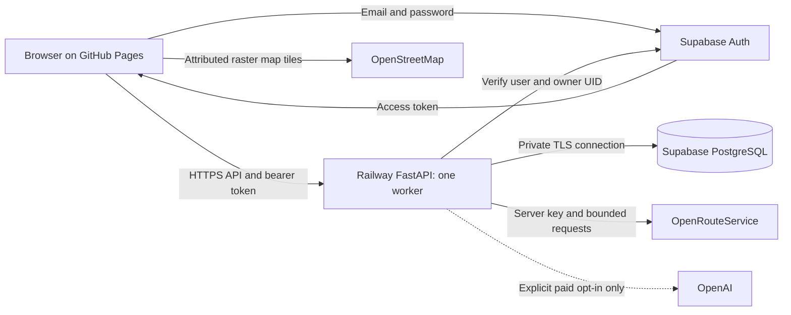

# Interactive app: Railway, Supabase and OpenRouteService

This repository now has a separate hosted entry point, a PostgreSQL durability
adapter, Supabase owner sign-in, an OpenRouteService adapter, and a gated GitHub
Pages export. This is deployment preparation. No cloud account, paid service,
production database, or new public deployment has been created by this work.

The existing Pages site remains in place until a real backend is configured and
the explicit publish workflow passes. The initial deployment is a private,
single-owner research prototype, with one backend worker and one replica.

## Cost recommendation

Start with Railway Free and sleeping enabled for intermittent development. A
stable, frequently used service may require Hobby; get the owner's approval
before switching plans or entering a paid commitment. Supabase Pro starts above
this project's entire budget and is not part of this design.

| Service | Initial choice | Important limit |
| --- | --- | --- |
| GitHub Pages | Existing public repository site | Static files only; the browser calls the backend |
| Railway | Free: $1 monthly usage credit | 512 MB RAM and one replica; a credit allowance does not promise continuous uptime |
| Railway, if later approved | Hobby: $5 minimum/month, including $5 of usage | Additional usage can raise the bill; target $5–10 total |
| Supabase | Free | 500 MB database, 5 GB egress; inactive projects can pause after one week |
| OpenRouteService | Standard, €0 | Directions 2,000/day and 40/min; Matrix 500/day and 40/min; Snap 2,000/day and 100/min |
| OpenAI | Disabled in hosted defaults | Enabling the live adapter makes model requests separately billable |

Railway bills RAM at $10/GB/month, CPU at $20/vCPU/month and egress at $0.05/GB.
For illustration, 0.5 GB average RAM, 0.05 average vCPU and 10 GB egress is about
$6.50/month on Hobby before taxes or other charges. These are assumed average
loads, not a measured bill or a service guarantee. One GB average RAM alone uses
the $10 budget. The Hobby minimum includes its usage allowance rather than
adding another $5 to that example. See [Railway plans](https://docs.railway.com/pricing/plans)
and [Supabase pricing](https://supabase.com/pricing).

Before an approved paid launch, set Railway's compute email alert to $5 and hard
limit to $10 in Workspace Usage. The documented minimum compute hard limit is
$10. Reaching it takes workloads offline; it is a cost protection, not an uptime
guarantee or a cap on unrelated OpenAI bills, taxes, or other services. Set
Railway Agent usage to zero and do not use its agent for deployment. Enable
Serverless under service Settings → Deploy to reduce idle costs. Avoid uptime
pings that keep a sleeping app awake. See [cost control](https://docs.railway.com/pricing/cost-control)
and [usage-limit rules](https://docs.railway.com/cli/usage).

## What is implemented

- `scripts/run_hosted_app.py` is the explicit Internet-facing launcher. The
  ordinary local launcher retains its loopback restrictions.
- `hosted.py` verifies API access through Supabase Auth and requires the configured
  owner's user ID. Successful sign-in by another account does not grant access.
  The interface offers sign-out without deleting saved itineraries or drafts.
- Only the backend origin, Supabase project URL and publishable/legacy anonymous
  key reach browser configuration. Secret keys, database passwords, routing keys
  and OpenAI keys stay on the backend. Service-role keys are rejected by the
  public exporter and hosted settings.
- `postgres_state.py` persists the existing atomic JSON/JSONL state in a private
  PostgreSQL schema. The filesystem is a fresh cache restored on startup. This
  preserves existing plan, decision, conversation, workspace and replay formats
  without pretending the ephemeral Railway disk is durable.
- Each API request is serialized, holds a database namespace lock, and commits
  changed files before its response is sent. A stale database revision or failed
  commit makes that process unusable until restarted; it does not silently
  overwrite newer state. The adapter bounds state to 4,096 files, 8 MiB per file,
  and 64 MiB total per owner namespace, below the free database allowance.
- Health checks verify runtime/database readiness without using ORS or OpenAI.
  "Configured" routing health does not claim that a live provider request passed.
- The hosted map uses the small vendored MapLibre runtime and standard OSM raster
  tiles, avoiding a large PMTiles download or a separate OSRM server. Attribution,
  a valid referrer and ordinary HTTP tile caching are retained. Do not add bulk
  downloads, offline prefetch or a tile proxy. The public tile service has no SLA;
  see the [OSM tile policy](https://operations.osmfoundation.org/policies/tiles/).
- Hosted interest exploration uses the labelled bundled catalog or previously
  saved online places. Its shared public Overpass lookup is disabled: that public
  endpoint is not a suitable discovery backend for a deployed app. Coverage is
  therefore bounded, particularly for new destinations. Local research mode
  retains its throttled lookup. See the [Overpass usage guidance](https://dev.overpass-api.de/overpass-doc/en/preface/commons.html).
- `ors_runtime.py` supports snapping, road directions and distance/time matrices.
  Coordinates and road provenance are validated throughout map edits and trip
  replanning. The same optimizer consumes provider-derived costs; the LLM still
  proposes typed changes and cannot bypass the evaluator or acceptance step.
- The ORS adapter limits the app to 30 combined requests/minute and 500 requests
  per rolling day, with bounded cached responses. Budget/cache records are
  persisted with app state. These limits are conservative app controls, not
  reserved provider quotas; other uses of the same key and a crash during an
  external request still count at the provider. Large new replans can exhaust
  the allowance, at which point the app reports a routing limit instead of
  inventing road evidence.
- The exporter keeps relative assets and query routes such as
  `/?view=map`, which survive reloads under the repository's Pages subdirectory.
  Publishing requires `/healthz` to report the same source build fingerprint.
  A missing setting or old backend stops the workflow before replacing Pages.

ORS now uses `https://api.heigit.org/openrouteservice/v2/...`. The earlier
`api.openrouteservice.org` host is deprecated. See the
[migration notice](https://ask.openrouteservice.org/t/deprecating-api-openrouteservice-org-in-favour-of-api-heigit-org/7912),
[current account plans](https://account.heigit.org/info/plans), and
[API restrictions](https://openrouteservice.org/restrictions/).

## Account and deployment steps

These steps require owner-controlled accounts. Do not paste secret values into
Git, browser configuration, an issue, a report, or a chat message.

1. Create a free Supabase project. In its SQL editor, run
   [`deploy/supabase/001_itinerary_state.sql`](../../deploy/supabase/001_itinerary_state.sql).
   The schema is private; anonymous and authenticated browser roles have no
   direct table access. Keep its database connection string private.
2. In Supabase Auth, disable public sign-ups and create one email/password user
   for the owner through the dashboard. Set `HOSTED_OWNER_ID` to that user's UUID.
   Set the Auth Site URL to the existing Pages project URL. No social login,
   password-reset email flow or public account registration is supplied here.
3. Copy the Supabase **session pooler** connection string (port 5432) for Railway
   if IPv4 connectivity is needed. Free direct connections use IPv6. URL-encode
   the database password. TLS `sslmode=require` is enforced at minimum;
   `verify-full` with a configured CA is preferable. The adapter disables prepared
   statements. See [connection methods](https://supabase.com/docs/guides/database/connecting-to-postgres).
4. Create a free HeiGIT/ORS account and obtain a Standard key. Do not assume
   eligibility for the higher-quota Collaborative plan. Put the key only in
   Railway's private service variables.
5. Create a Railway Free project and connect this repository's release branch.
   The root Dockerfile packages the three registered immutable demo runs and
   required route evidence, without notebooks, local sessions, OSRM or PMTiles.
   Do not add a Railway database or volume: Supabase is the state authority.
   Use one replica and one worker; set health-check path `/healthz`.
6. Supply variables from [`deploy/hosted.env.example`](../../deploy/hosted.env.example).
   Generate the Railway HTTPS domain and set `HOSTED_API_ORIGIN` to that exact
   origin. Set `HOSTED_FRONTEND_ORIGIN=https://ztang-yit-xiaang.github.io`, without
   the repository path. Keep `PRODUCT_COPILOT_ADAPTER=deterministic` and
   `HOSTED_ENABLE_PAID_OPENAI=false`.
7. The reviewed infrastructure declaration is `.railway/railway.ts`. It declares
   the app service only, with private values preserved. Current Railway uses its
   TypeScript infrastructure format; do not substitute an obsolete
   `railway.toml` recipe for a new service. Review the SDK's plan before any apply.
   Applying it creates resources and remains an owner-controlled action. See
   [Railway infrastructure-as-code](https://docs.railway.com/infrastructure-as-code).
8. Verify the backend's `/healthz`, owner sign-in, map display and saved workspace
   after restarting the service. Perform one explicitly approved ORS route test;
   a configured adapter and mocked contract tests do not prove real credentials,
   provider access or regional route availability. Do not enable paid OpenAI as
   part of this free-hosting smoke test.
9. In GitHub repository or `github-pages` environment variables, set only
   `HOSTED_API_ORIGIN`, `SUPABASE_URL`, and `SUPABASE_PUBLISHABLE_KEY`. Select the
   same source revision used by Railway and manually run **deploy interactive app
   pages**. The existing Pages branch setting remains `gh-pages` at `/`.
10. At the public Pages URL, check sign-in, query-route reload, map zoom/pan,
    interest settings, one evaluated edit, evidence download, sign-out and
    sign-in, then verify state again after a Railway restart. Save actual live
    receipts before calling the deployment accepted.

## Recovery and practical limits

The first release supports one owner and one backend process. Do not enable
horizontal autoscaling or multiple workers. Database revision fencing rejects a
stale overlapping instance; it does not merge independent in-memory workspaces.
Deploy with the old instance drained, then restart once if a stale revision is
reported. A public multi-user product needs separate per-user runtime/state
isolation before lifting this restriction.

Hosted chat currently buffers the response until its database commit succeeds.
The browser receives the final event sequence at completion rather than a live
token stream. Responses are bounded to 16 MiB. Long solver/provider work can also
hit request timeouts or a low-memory limit. Free-tier capacity must be measured
under real use; do not infer acceptable peak memory from a healthy idle process.

The final local Linux image completed startup, owner-bound API access, a saved
selection and PostgreSQL restart restoration under a 512 MiB container limit.
Its observed process peak was 318.62 MiB for that small test. No whole-trip solve
or live provider request was included, so this does not establish that the free
memory limit is sufficient for every optimizer request.

Supabase may pause an inactive free project; resume it in the dashboard, then
restart Railway to restore the cache. Do not run artificial traffic to evade
free-tier inactivity rules. Free service plans provide limited recovery options;
make owner-controlled database backups before relying on important plans. See
[free project pausing](https://supabase.com/docs/guides/platform/free-project-pausing).

ORS supplies road routing, not ferry schedules, park opening guarantees or live
wildfire clearance. Existing curated ferry evidence remains distinct from road
legs. OSM tiles and nearby-place services can fail independently; saved catalog
fallbacks must remain visibly labeled.

If a new frontend/backend version fails, restore both to the same previous source
revision and rerun the gated export. The legacy Pages snapshot before this work
was `5f245cc3dda512a94257f2060abd78f0e9100d55`; preserve that history. Do not
reset or delete the Supabase namespace to repair a frontend deployment. Restore
state from a reviewed backup only when necessary and with explicit approval.

Current executed checks and their limits are recorded in the
[release verification report](../reports/full_app_release_20261029/README.md).
