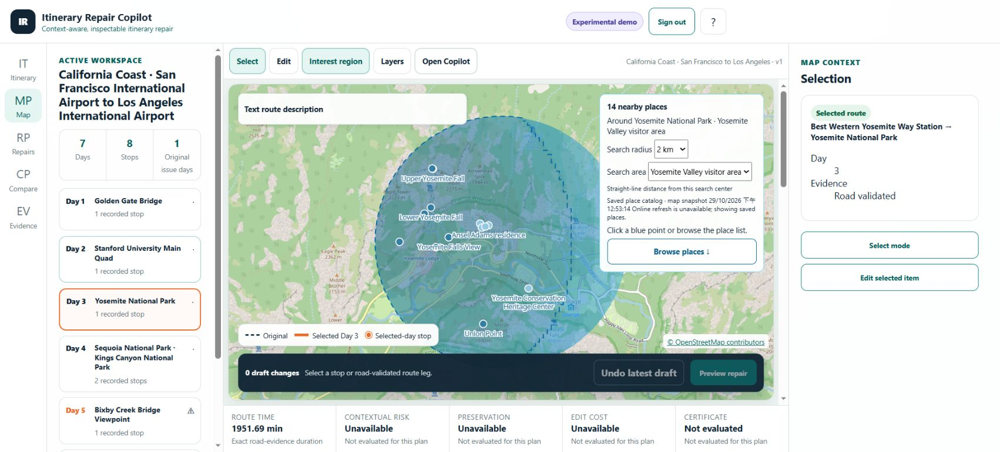
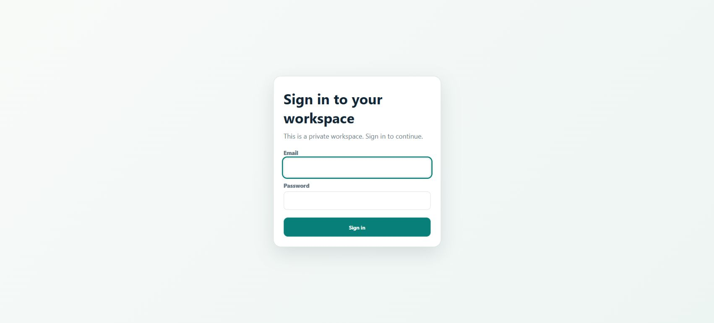

# Interactive hosting preparation and interest-map verification

The README and real-browser walkthrough are updated. The newer interest-map
source and a deployment package for Railway + Supabase + ORS are implemented.
**No cloud deployment or paid service was provisioned.** The old GitHub Pages
site has not been replaced; publication is gated on a matching ready backend.

Use the [deployment guide](../../deployment/railway_supabase_ors.md) for costs,
private settings, the migration, setup and recovery. This report records local
execution, including synthetic authentication, separately from live acceptance.

## Source and scope

- Final app build: `d50d8ba9ec56a322`.
- Final Docker image: `sha256:a641d45fbf01cb3cbd474aee7f9ab268907f6a86197236574d991a4c712ad359`.
- The source imports the newer interest catalog, visitor-area search centers,
  saved preferences and registered composite-route validation from the separate
  development checkout. It does not copy that checkout's private sessions or its
  deleted run directories. The three registered immutable runs remain intact.
- [verification.json](verification.json) binds selected test receipts, source
  hashes and screenshots. Retained media is evidence, not an invented mockup.

## Findings and fixes

| Finding | Resolution | Verification boundary |
| --- | --- | --- |
| Earlier default-parent interest lookup rejected a registered additive matrix | Accept only its hash-bound composite matrix/bundle IDs | Local API and browser; original older-source failure remains in README capture history |
| Broad park pins gave unhelpful nearby results | Use labelled visitor-area centers with the original pin still selectable | Yosemite visitor-area browser checks; accepted stops remain unchanged |
| Hosted filesystem alone would lose saved state on replacement | Private PostgreSQL state authority, fresh cache restore, revision fencing and commit before response | Real disposable PostgreSQL 16, including restart and denied browser roles |
| Unexpected core failure could commit partial cache state; timed-out workers could keep writing | Reject uncertain 499/500/504 outcomes, discard buffered response and poison that runtime | Failure injection; expected provider 503 still preserves its budget and remains usable |
| CORS preflight could bypass the Host check | Enforce Host outside CORS, with Railway's special host allowed only on `/healthz` | Hosted boundary tests |
| New provider validation rejected existing saved map edits | Normalize serialized `travel_mode` into the validator's `routing_profile` | Confirmed waypoint API regression tests; mixed provider evidence remains rejected |
| A direct evidence ZIP link would omit hosted authentication | Download through the authenticated API client, preserving the displayed plan ID | Executable frontend download and ownership tests |
| GitHub Pages cannot resolve backend `/app/...` navigation paths | Use relative static assets and `?view=...` routing under the project subpath | Export tests and local browser reload |

## Executed checks

The final focused backend run passed **447 checks with 1 skip**, recorded in
`regression-final.xml` and `verification.json`. It covers runtime configuration, core API,
interest/context/composite routes, retention, workspace, confirmed waypoints,
snap previews, trip planning, packaging, export and local security.

Additional receipts retain:

- `hosted-final.xml`: 91 passed, including the hosted boundary, real PostgreSQL
  session restoration, confirmed-waypoint and retention cases.
- `postgres-real-final.xml`: 83 passed, 2 Windows-specific skips. The test database
  included `anon`, `authenticated` and `service_role` roles to exercise revokes.
- `providers.xml`: 228 passed across ORS, existing routing, map interactions and
  nearby-place cache behavior. All provider transports were synthetic/offline.
- `pages-export.xml`: 9 passed; stale backend, invalid key and existing output
  cases fail without replacing the site.
- `frontend-focused.txt`: 58 passed for hosted auth/sign-out/download, raster
  origin/path validation, provider provenance and camera behavior.
- `frontend-wrappers.xml` and `frontend-ownership.xml`: 117 wrapper checks passed
  initially; one assertion still expected the removed direct ZIP link. Its
  selected-plan ownership subset passed all 21 checks after updating that
  assertion. These receipts overlap and should not be added together.
- Final Ruff lint/format and JavaScript syntax checks passed.

The larger standalone Node batch was **not a complete pass**: the worker recorded
483 passes, 10 missing-input failures and 2 skips. Fixture-backed wrappers are
the supported path for those data-dependent suites. An archived runtime replay
also still needs authentic typed-capture inputs for its positive normalization
case. This work does not declare the full historical browser/language gate
complete, or reuse the older 4,815-test CI result as proof for this new source.

## Browser checks

Screenshots 01–04 use the earlier local build `d417281312091261`, the real local
map runtime and saved-catalog fallback. They establish the repaired default
parent, Golden Gate 2 km search, preference retention and Yosemite visitor area.
An attempted live nearby-place lookup was unavailable; it was not a live-source
pass. These checks did not accept or stage itinerary changes.

Screenshots 05 onward use final build `d50d8ba9ec56a322`. They run the real frontend
under `/demo/` on one loopback origin, the real FastAPI app on a second origin,
and a real temporary PostgreSQL database. **Sign-in uses a synthetic local Auth
service; no Supabase account or live Auth credential is exercised.** ORS and
OpenAI requests are disabled. OSM map tiles are real browser requests.

The browser opened the map, selected Yosemite, showed 14 catalog places within
2 km, applied More nature and 95% region, and retained those settings and Day 3
after a query-route reload. Sign-out returned to the login form. After restarting
the backend with a new empty cache, signing in restored Day 3 and the same
settings; screenshot 14 records that check. The settled
zoom before/after estimate refresh is retained in screenshots 11 and 12; camera
logic also has its separate executable tests. This is not a claim about all zoom,
device or network combinations.

## Container verification and remaining live gate

The final image ran as UID 10001, with a 512 MiB limit, using the real local
PostgreSQL instance. Readiness returned 200, unauthenticated API access 401,
session creation and selection 200, and a fresh runtime restored the saved
selection. Observed process peak RSS was 318.62 MiB. This small test did not run a
whole-trip MILP or a live provider request and does not establish their peak RAM.

Remaining owner-controlled setup: create the free accounts, apply the private
schema, create the owner Auth user, set private backend variables, verify one
real ORS request and actual cloud persistence, then run the gated Pages publish.
Paid plans and paid OpenAI remain off until separately approved. Initially use
one owner, one worker and one replica; hosted chat buffers until durable commit,
and hosted place exploration uses bounded saved catalog coverage.

Temporary test services, database, dependency copies and owned build artifacts
are cleaned after the compact receipts and screenshots are retained. User
workspaces, saved sessions and unrelated caches are outside that cleanup.
